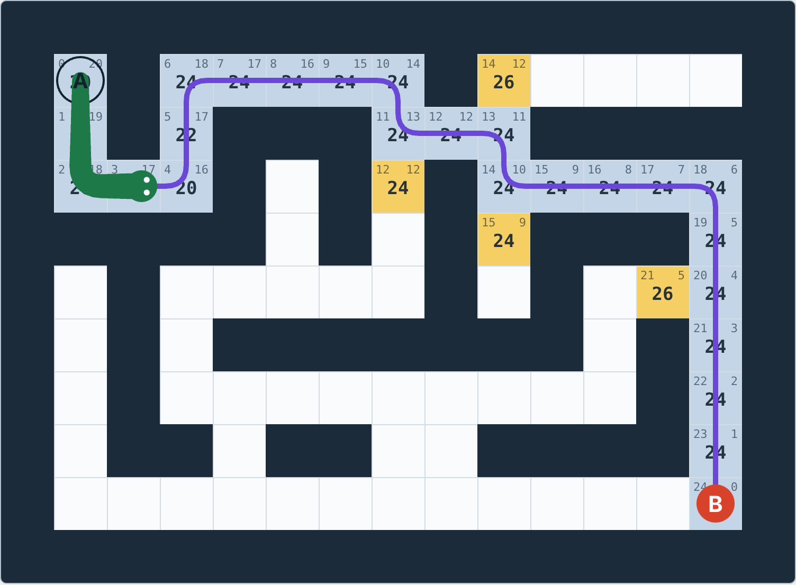

# A* Snake Maze

A snake finds its way through a maze using the **A\* pathfinding algorithm**. You can watch the search think, one cell at a time, and switch to a mode where the snake can't see the maze and has to explore it.

Built with plain HTML, CSS and JavaScript (plus [Three.js](https://threejs.org/) for the 3D view). No build step.

## Run it

Open `index.html` in a browser. That's it. It works straight from disk.

## What it shows

- **A\* search:** every cell gets `f = g + h`, where `g` is the real cost from the start, `h` is a guess of the cost left, and the cell with the lowest `f` is explored next. Turn on *Show g, h and f in cells* and press *Step* to follow it.
- **Compare algorithms:** A\*, Dijkstra (no guess) and Weighted A\* (a deliberately too-high guess).
- **4 or 8 directions:** diagonal steps cost about 1.41.
- **Natural movement:** the grid path is smoothed and its corners rounded, and the snake glides along it.
- **Explore mode:** the maze is hidden by fog. The snake plans as if unseen cells are open, then replans whenever it finds a wall.
- **2D and 3D views:** including a chase camera that follows the snake.
- **Editable maze:** click or drag to add and remove walls, and drag A and B to move them.

## How it is organized

| File | Job |
|---|---|
| `js/astar.js` | The A\* search. It only takes a maze and returns a path. |
| `js/heap.js` | Min-heap used as A\*'s waiting list (the open list) |
| `js/maze.js` | Random maze generation (recursive backtracker, plus extra loops) |
| `js/path.js` | Path smoothing, corner rounding and the snake's trail |
| `js/game.js` | Game state and rules, as a small phase-based state machine |
| `js/config.js` | Constants: sizes, speeds, moves, vision |
| `js/render.js`, `js/render3d.js` | 2D (canvas) and 3D (Three.js) drawing. They only read the game state. |
| `js/main.js` | Buttons, settings and the animation loop |
| `js/vendor/` | Three.js (MIT license) |

The search knows nothing about the snake or the screen, so movement, exploring and 3D could all be added without changing the algorithm.

## Tested

Across about 900 random mazes and settings, the cost A\* finds matched Dijkstra's (the true shortest), while expanding fewer cells. In explore mode the snake reached its goal every time and travelled about 13% farther than the shortest path on average.

## License

Add the license you prefer. Three.js in `js/vendor/` is MIT licensed (see `js/vendor/three.LICENSE.txt`).
